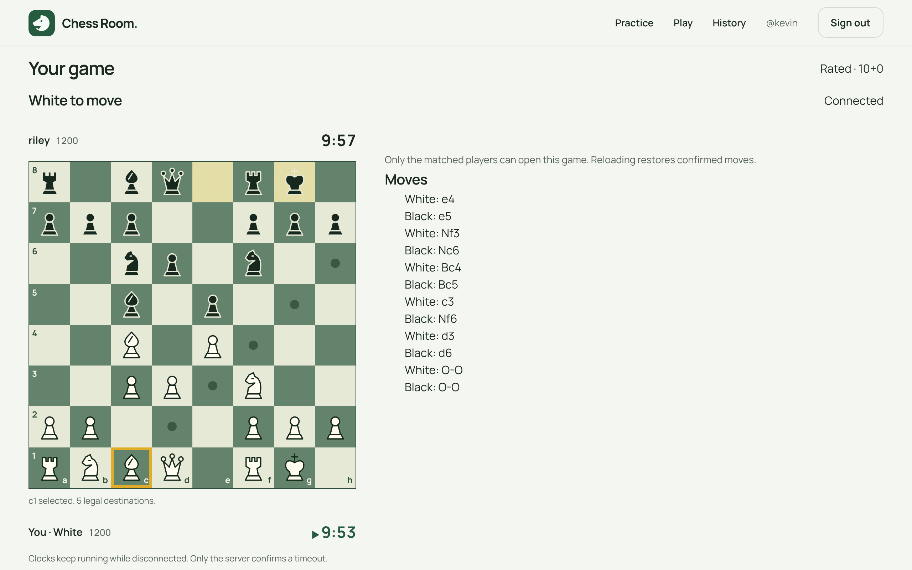

# Chess Room

[](https://github.com/kplaza1009-create/chess-app/actions/workflows/ci.yml)

**A full-stack, real-time multiplayer chess application built with React, TypeScript, Python, FastAPI, and PostgreSQL.**

Chess Room is an in-development web app for playing chess with other people. It includes a **custom chess engine written in Python (without `python-chess`)**, interactive boards, authenticated accounts, persistent online games, server-controlled clocks, and rating-based matchmaking.



> **Project status:** Active development — **Phase 9 completed**. The repository is a working development build, not yet a publicly deployed production service.

## Features

### Implemented

- **Custom chess engine:** Legal move generation, check and checkmate, castling, en passant, pawn promotion, stalemate, repetition, move-count draws, and insufficient-material detection.
- **Interactive board:** Select or drag pieces, see legal destinations, choose promotions, and practice locally at `/practice`.
- **Accounts and sessions:** Registration, login, logout, session restoration, password hashing, and access/refresh token handling.
- **Online multiplayer:** Two-player private rooms, WebSocket-based position updates, persistent moves, and reconnect handling.
- **Timed games:** Bullet, blitz, and rapid formats with authoritative server clocks, increments where applicable, and timeout adjudication.
- **Rated matchmaking:** A PostgreSQL-backed queue that pairs players on the same time control using a widening rating window; queue cancellation on navigation and page exit.
- **Elo ratings:** Separate bullet, blitz, and rapid ratings with transactional updates after eligible rated games.
- **Game history and replay:** Private game history, forward/back controls, direct move selection, and board flipping.
- **PGN import/export:** Download completed games or import a validated main line into a separate personal, unrated archive.
- **Testing and validation:** Engine/perft tests, backend integration tests, frontend component tests, static checks, and network smoke-test scripts.

### Planned

- Computer opponent using minimax and alpha-beta pruning
- Spectator mode, chat, draw offers, resignation, and rematches
- Leaderboards and expanded user profiles
- Further security/performance work and public deployment

Planned features are **not** represented as completed functionality.

## Technology stack

| Layer | Tools |
| --- | --- |
| Frontend | React 19, TypeScript, Vite, Tailwind CSS, React Router |
| Backend | Python 3.12, FastAPI, WebSockets |
| Database | PostgreSQL, SQLAlchemy 2.0, Alembic |
| Authentication | JWT access/refresh tokens, bcrypt |
| Chess logic | Custom Python engine; no third-party chess-rules library |
| Testing | pytest, Vitest, React Testing Library, perft, Ruff, mypy |
| Development environment | Docker, Docker Compose |

## How it works

1. A player registers or signs in through the React frontend.
2. The player can practice locally, create an unrated private game, or join the rated matchmaking queue.
3. Matchmaking uses PostgreSQL transactions to pair eligible players. Each online match is represented by a persisted game record.
4. The FastAPI server validates moves using the custom chess engine and synchronizes game state over authenticated WebSockets.
5. For rated games, the backend settles results and Elo changes together in a database transaction, with separate rating pools for different speeds.

**Engineering highlights:** The authoritative game state lives on the server; moves are versioned and persisted; players can reconnect; clocks use persisted server timestamps; and rating settlement is designed to avoid duplicate updates.

## Run locally

### Requirements

- Docker Desktop (or Docker Engine with Docker Compose)
- Python 3, for the included local configuration helper

From the **`chess-app` project root** (the folder containing `compose.yaml`):

```bash
# 1. Generate a local .env file and signing secret.
python3 scripts/configure_env.py

# 2. Build and start the database, migrations, API, and frontend.
docker compose up --build -d

# 3. Check that the services started.
docker compose ps
```

Open:

- **Frontend:** http://localhost:5173
- **Play / matchmaking:** http://localhost:5173/play
- **Local practice:** http://localhost:5173/practice
- **History and PGN:** http://localhost:5173/history
- **API documentation (development only):** http://localhost:8000/docs

To try multiplayer, open the site in **two separate browser profiles** and sign in with different accounts. Choose the same time control and select **Find opponent** on each account. Alternatively, create a private room and invite another registered user.

Stop the application with:

```bash
docker compose down
```

**Existing installations:** Preserve your original `.env` and PostgreSQL volume when updating. Do not run `docker compose down -v` unless you intentionally want to delete local database data. Never commit your actual `.env` file or production credentials.

## Tests and quality checks

Run these from the project root while Docker is available:

```bash
# Backend unit, engine, and integration tests against a separate test database.
docker compose --profile test run --build --rm test

# Frontend production build and test suite.
docker compose --profile test run --build --rm frontend_test

# Verify database migrations after the development stack is running.
docker compose exec api alembic check
```

**Phase 9 verification:**

- 521 backend tests passed; nine optional deep-perft cases skipped
- 73 frontend tests passed
- Production frontend build, Ruff, mypy, and Alembic checks passed
- Real-server tests covered matchmaking, rated play, PGN round trips, archive privacy, and move delivery

See [`docs/PHASE9.md`](docs/PHASE9.md) for exact commands, measurements and limitations. The board, game and history browser smoke tests pass in Chromium. Docker/Nginx runtime was not executed.

## Repository layout

```text
chess-app/
├── backend/
│   ├── app/
│   │   ├── api/           # Authentication, boards, games, matchmaking
│   │   ├── chess/         # Custom chess engine and notation
│   │   ├── db/            # Models and database access
│   │   └── services/      # Clocks, ratings, matchmaking, security
│   ├── alembic/           # Database schema migrations
│   ├── engine_tests/      # Chess rules and perft tests
│   └── tests/             # API and integration tests
├── frontend/
│   ├── src/components/    # Board, pieces, clocks, layouts
│   ├── src/pages/         # Practice, matchmaking, game, auth
│   └── src/test/          # UI and client tests
├── scripts/               # Local environment setup
├── docs/                  # Roadmap, phase notes, and review records
├── .github/workflows/     # CI: tests, linting, type checks on every push
├── compose.yaml           # Development/test service definitions
└── .env.example           # Example configuration (safe to commit)
```

## Current limitations

This is a development-stage portfolio project. The computer opponent, spectator/chat features, full public deployment, and some production hardening are future work. PGN import saves one standard-chess main line at a time; comments and variations are discarded, and size/work limits apply. Matchmaking currently prioritizes correctness over high-throughput queue scaling. Read [`docs/PHASE9.md`](docs/PHASE9.md) and [`docs/PROJECT_PLAN.md`](docs/PROJECT_PLAN.md) for the current boundaries.

## How it was built

Built with AI coding assistants. I designed the phase plan, set the requirements, and independently reviewed and tested each phase before moving on.

## Project documentation

- [`docs/PROJECT_PLAN.md`](docs/PROJECT_PLAN.md) — goals, milestones, and remaining phases
- [`docs/PHASE9.md`](docs/PHASE9.md) — game history, replay, PGN, and current verification
- [`docs/PHASE8.md`](docs/PHASE8.md) — current matchmaking/rating implementation and verification
- [`docs/PHASE7.md`](docs/PHASE7.md) — persistent clocks and opening deadlines
- [`docs/AUTH_TIMEZONE_FIX.md`](docs/AUTH_TIMEZONE_FIX.md) — UTC refresh-cookie fix and regressions

---

**Created by Kevin Plaza** · Computer Science student · Work in progress
